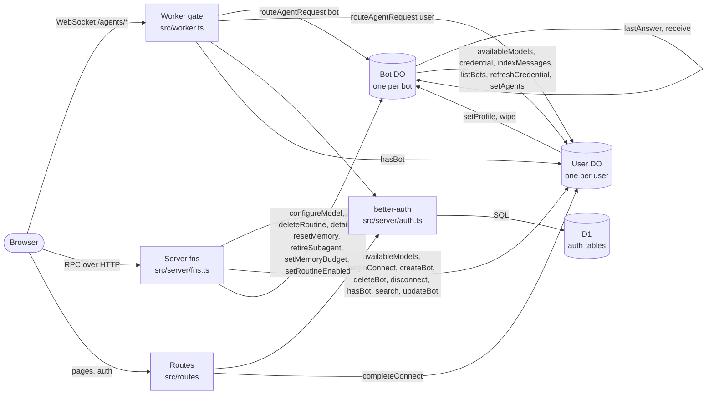

# Architecture

<!-- Generated by scripts/infra-map.ts from the code and the local SQLite files. Do not edit; run `node scripts/infra-map.ts`. `--check` verifies. -->

## Map

## Objects

| Binding | Kind | Class | Instance key | Owner |
|---|---|---|---|---|
| `DB` | D1.Database | - | - | shared by all users, better-auth tables only |
| `BETTER_AUTH_SECRET` | secret (.env) | - | - | Worker env |
| `User` | Durable Object | User extends Agent (src/server/user.ts) | user id | one instance per user |
| `Bot` | Durable Object | Bot extends DurableObject + Lifecycle + PiHarness (src/server/bot.ts) | `<userId>--<botId>` | one instance per bot in the user's User catalog |

## Storage

Scope: `user`/`bot` = per User/Bot instance, `shared` = D1, `agent` = agents SDK runtime state, `runtime` = workerd.

| Object | Table / kv key | Source | Owner scope | Writers | Readers | In SQLite |
|---|---|---|---|---|---|---|
| D1 | `user` | code: migrations/0001_better_auth.sql:1 | shared | better-auth (server/auth.ts) | better-auth (server/auth.ts) | yes |
| D1 | `session` | code: migrations/0001_better_auth.sql:3 | shared | better-auth (server/auth.ts) | better-auth (server/auth.ts) | yes |
| D1 | `account` | code: migrations/0001_better_auth.sql:5 | shared | better-auth (server/auth.ts) | better-auth (server/auth.ts) | yes |
| D1 | `verification` | code: migrations/0001_better_auth.sql:7 | shared | better-auth (server/auth.ts) | better-auth (server/auth.ts) | yes |
| D1 | `__alchemy_migrations` | library: alchemy | shared | alchemy | alchemy | yes |
| D1 | `_cf_METADATA` | library: workerd internals | runtime | workerd internals | workerd internals | yes |
| User | `bots` | code: server/user.ts:17 | user | server/user.ts:50, server/user.ts:81, server/user.ts:83, server/user.ts:103, server/user.ts:115 | server/user.ts:24, server/user.ts:42, server/user.ts:49, server/user.ts:67, server/user.ts:127 | yes |
| User | `bot_agents` | code: server/user.ts:18 | user | server/user.ts:91, server/user.ts:92, server/user.ts:102 | server/user.ts:25 | yes |
| User | `indexed` | code: server/user.ts:19 | user | server/user.ts:101, server/user.ts:112 | - | yes |
| User | `messages` (FTS5) | code: server/user.ts:20 | user | server/user.ts:100, server/user.ts:113 | server/user.ts:127 | yes |
| User | kv `siwc:connection` | code: server/user.ts:146 | user | server/user.ts:156, server/user.ts:161, server/user.ts:202 | server/user.ts:146, server/user.ts:168, server/user.ts:196 | n/a |
| User | kv `siwc:host` | code: server/user.ts:140 | user | server/user.ts:141 | server/user.ts:140 | n/a |
| User | kv `siwc:models` | code: server/user.ts:162 | user | server/user.ts:162, server/user.ts:189 | server/user.ts:175 | n/a |
| User | kv `siwc:pending` | code: server/user.ts:147 | user | server/user.ts:147, server/user.ts:154 | server/user.ts:152 | n/a |
| User | `messages_config`, `messages_content`, `messages_data`, `messages_docsize`, `messages_idx` | library: FTS5 shadow tables of `messages` | user | FTS5 shadow tables of `messages` | FTS5 shadow tables of `messages` | yes |
| User | `cf_agent_tool_runs`, `cf_agents_facet_runs`, `cf_agents_fibers`, `cf_agents_jobs`, `cf_agents_mcp_servers`, `cf_agents_runs`, `cf_agents_state`, `cf_agents_task_runs`, `cf_agents_task_steps`, `cf_agents_workflows` | library: agents SDK (Agent / Lifecycle) | agent | agents SDK (Agent / Lifecycle) | agents SDK (Agent / Lifecycle) | yes |
| User | `_cf_KV`, `_cf_METADATA` | library: workerd internals | runtime | workerd internals | workerd internals | yes |
| Bot | `optchat_log` | code: optchat/store.ts:6 | bot | optchat/store.ts:17 | optchat/store.ts:11 | yes |
| Bot | `optchat_tree` | code: optchat/store.ts:7 | bot | optchat/store.ts:21 | optchat/store.ts:12 | yes |
| Bot | `optchat_view` | code: optchat/store.ts:8 | bot | optchat/store.ts:25 | optchat/store.ts:13 | yes |
| Bot | `routines` | code: server/bot.ts:115 | bot | server/bot.ts:279, server/bot.ts:287, server/bot.ts:300, server/bot.ts:307 | server/bot.ts:272, server/bot.ts:292 | yes |
| Bot | kv `bot:profile` | code: server/bot.ts:127 | bot | server/bot.ts:139 | server/bot.ts:127 | n/a |
| Bot | kv `index:sent` | code: server/bot.ts:360 | bot | server/bot.ts:368 | server/bot.ts:360 | n/a |
| Bot | kv `memory:budget` | code: server/bot.ts:193 | bot | server/bot.ts:251 | server/bot.ts:193 | n/a |
| Bot | kv `optchat:cursor` | code: server/bot.ts:220 | bot | server/bot.ts:236, server/bot.ts:265 | server/bot.ts:220, server/bot.ts:264 | n/a |
| Bot | `cf_agents_jobs` | library: agents SDK (Agent / Lifecycle) | agent | agents SDK (Agent / Lifecycle) | agents SDK (Agent / Lifecycle) | yes |
| Bot | `pi_conversations`, `pi_document_revisions`, `pi_documents`, `pi_durable_metadata`, `pi_durable_schema`, `pi_entries`, `pi_record_ids`, `pi_submissions`, `pi_tasks` | library: pi-durable (PiHarness) | bot | pi-durable (PiHarness) | pi-durable (PiHarness) | yes |
| Bot | `_cf_KV`, `_cf_METADATA` | library: workerd internals | runtime | workerd internals | workerd internals | yes |

## RPC edges

| From | To | Method | file:line |
|---|---|---|---|
| Bot | Bot | `lastAnswer` | src/server/bot.ts:103 |
| Bot | Bot | `receive` | src/server/bot.ts:102 |
| Bot | User | `availableModels` | src/server/bot.ts:146, src/server/bot.ts:184 |
| Bot | User | `credential` | src/server/bot.ts:91, src/server/bot.ts:182 |
| Bot | User | `indexMessages` | src/server/bot.ts:367 |
| Bot | User | `listBots` | src/server/bot.ts:101 |
| Bot | User | `refreshCredential` | src/server/bot.ts:91, src/server/bot.ts:182 |
| Bot | User | `setAgents` | src/server/bot.ts:106 |
| Server fns | Bot | `configureModel` | src/server/fns.ts:37 |
| Server fns | Bot | `deleteRoutine` | src/server/fns.ts:55 |
| Server fns | Bot | `details` | src/server/fns.ts:41 |
| Server fns | Bot | `resetMemory` | src/server/fns.ts:49 |
| Server fns | Bot | `retireSubagent` | src/server/fns.ts:58 |
| Server fns | Bot | `setMemoryBudget` | src/server/fns.ts:46 |
| Server fns | Bot | `setRoutineEnabled` | src/server/fns.ts:52 |
| Server fns | User | `availableModels` | src/server/fns.ts:24 |
| Server fns | User | `beginConnect` | src/server/fns.ts:18 |
| Server fns | User | `createBot` | src/server/fns.ts:28 |
| Server fns | User | `deleteBot` | src/server/fns.ts:34 |
| Server fns | User | `disconnect` | src/server/fns.ts:19 |
| Server fns | User | `hasBot` | src/server/fns.ts:12 |
| Server fns | User | `search` | src/server/fns.ts:22 |
| Server fns | User | `updateBot` | src/server/fns.ts:31 |
| User | Bot | `setProfile` | src/server/user.ts:73 |
| User | Bot | `wipe` | src/server/user.ts:99 |
| Worker gate | User | `hasBot` | src/worker.ts:24 |
| Worker route | User | `completeConnect` | src/routes/auth.callback.ts:11 |

## Routes

| Path | Auth rule |
|---|---|
| `/agents/bot/:name` | 401 without session; 404 unless exactly `/agents/bot/:name`; 403 unless `name` is `<callerId>--<botId>` and `User.hasBot(botId)` |
| `/agents/user/:name` | 401 without session; 404 unless exactly `/agents/user/:name`; 403 unless `name` is the caller's id |
| `everything else` | TanStack Start handler (rule per route below) |
| `/api/auth/*` | better-auth handler (sign-in/up are public) |
| `/auth/callback` | `requireUser`: 401 without session |
| `/` | session or redirect to /login |
| `/login` | public |
| `serverFn getSession (GET)` | public (returns session or null) |
| `serverFn connectChatGPT (POST)` | `requireUser` |
| `serverFn disconnectChatGPT (POST)` | `requireUser` |
| `serverFn searchMessages (GET)` | `requireUser` |
| `serverFn modelOptions (GET)` | `requireUser` |
| `serverFn createBot (POST)` | `requireUser` |
| `serverFn updateBot (POST)` | `requireUser` + `User.hasBot` |
| `serverFn deleteBot (POST)` | `requireUser` + `User.hasBot` |
| `serverFn setBotModel (POST)` | `requireUser` + `User.hasBot` |
| `serverFn botDetails (GET)` | `requireUser` + `User.hasBot` |
| `serverFn setMemoryBudget (POST)` | `requireUser` + `User.hasBot` |
| `serverFn resetMemory (POST)` | `requireUser` + `User.hasBot` |
| `serverFn setRoutineEnabled (POST)` | `requireUser` + `User.hasBot` |
| `serverFn deleteRoutine (POST)` | `requireUser` + `User.hasBot` |
| `serverFn retireSubagent (POST)` | `requireUser` + `User.hasBot` |
