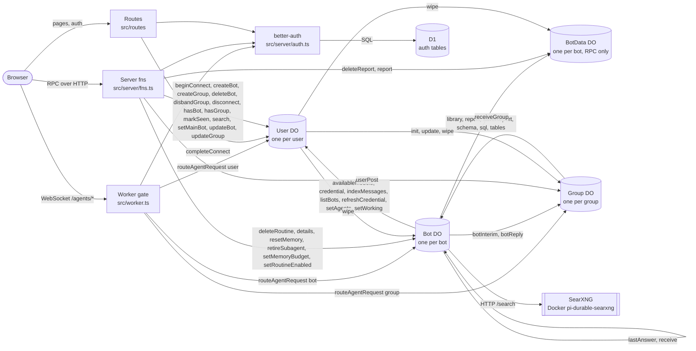

# Architecture

<!-- Generated by scripts/infra-map.ts from the code and the local SQLite files. Do not edit; run `node scripts/infra-map.ts`. `--check` verifies. -->

## Map

## Objects

| Binding | Kind | Class | Instance key | Owner |
|---|---|---|---|---|
| `DB` | D1.Database | - | - | shared by all users, better-auth tables only |
| `BETTER_AUTH_SECRET` | secret (.env) | - | - | Worker env |
| `SEARXNG_URL` | plain var | - | - | Worker env |
| `User` | Durable Object | User extends Agent (src/server/user.ts) | user id | one instance per user |
| `Bot` | Durable Object | Bot extends DurableObject + Lifecycle + PiHarness (src/server/bot.ts) | `<userId>--<botId>` | one instance per bot in the user's User catalog |
| `BotData` | Durable Object | BotData extends DurableObject (src/server/bot-data.ts) | `<userId>--<botId>` | one instance per bot, same name as its Bot; RPC only, no /agents door |
| `Group` | Durable Object | Group extends Agent (src/server/group.ts) | `<userId>--<groupId>` | one instance per group in the user's User catalog |

## Containers

Docker resources of the alchemy stack (not Worker bindings); the Worker reaches them over a plain-var URL.

| Resource | Container | Image | Port (host -> container) | Used by |
|---|---|---|---|---|
| `Searxng` | pi-durable-searxng | searxng/searxng:2026.10.4-d48c4b555 | 8888 -> 8080 | server/bot.ts:103 |

## Storage

Scope: `user`/`bot`/`group` = per User/Bot/Group instance, `shared` = D1, `agent` = agents SDK runtime state, `runtime` = workerd.

| Object | Table / kv key | Source | Owner scope | Writers | Readers | In SQLite |
|---|---|---|---|---|---|---|
| D1 | `user` | code: migrations/0001_better_auth.sql:1 | shared | better-auth (server/auth.ts) | better-auth (server/auth.ts) | yes |
| D1 | `session` | code: migrations/0001_better_auth.sql:3 | shared | better-auth (server/auth.ts) | better-auth (server/auth.ts) | yes |
| D1 | `account` | code: migrations/0001_better_auth.sql:5 | shared | better-auth (server/auth.ts) | better-auth (server/auth.ts) | yes |
| D1 | `verification` | code: migrations/0001_better_auth.sql:7 | shared | better-auth (server/auth.ts) | better-auth (server/auth.ts) | yes |
| D1 | `__alchemy_migrations` | library: alchemy | shared | alchemy | alchemy | yes |
| D1 | `_cf_METADATA` | library: workerd internals | runtime | workerd internals | workerd internals | yes |
| User | `bots` | code: server/user.ts:17 | user | server/user.ts:22, server/user.ts:68, server/user.ts:122, server/user.ts:127, server/user.ts:129, server/user.ts:168, server/user.ts:215 | server/user.ts:30, server/user.ts:36, server/user.ts:58, server/user.ts:62, server/user.ts:89, server/user.ts:227 | yes |
| User | `groups` | code: server/user.ts:24 | user | server/user.ts:180, server/user.ts:195, server/user.ts:203 | server/user.ts:38, server/user.ts:186 | yes |
| User | `bot_agents` | code: server/user.ts:25 | user | server/user.ts:137, server/user.ts:138, server/user.ts:166 | server/user.ts:37 | yes |
| User | `indexed` | code: server/user.ts:26 | user | server/user.ts:165, server/user.ts:212 | - | yes |
| User | `messages` (FTS5) | code: server/user.ts:27 | user | server/user.ts:164, server/user.ts:213 | server/user.ts:227 | yes |
| User | `glance` | code: server/user.ts:29 | user | server/user.ts:30, server/user.ts:69, server/user.ts:145, server/user.ts:152, server/user.ts:167 | server/user.ts:36 | yes |
| User | kv `siwc:connection` | code: server/user.ts:246 | user | server/user.ts:256, server/user.ts:261, server/user.ts:302 | server/user.ts:246, server/user.ts:268, server/user.ts:296 | n/a |
| User | kv `siwc:host` | code: server/user.ts:240 | user | server/user.ts:241 | server/user.ts:240 | n/a |
| User | kv `siwc:models` | code: server/user.ts:262 | user | server/user.ts:262, server/user.ts:289 | server/user.ts:275 | n/a |
| User | kv `siwc:pending` | code: server/user.ts:247 | user | server/user.ts:247, server/user.ts:254 | server/user.ts:252 | n/a |
| User | `messages_config`, `messages_content`, `messages_data`, `messages_docsize`, `messages_idx` | library: FTS5 shadow tables of `messages` | user | FTS5 shadow tables of `messages` | FTS5 shadow tables of `messages` | yes |
| User | `cf_agent_tool_runs`, `cf_agents_facet_runs`, `cf_agents_fibers`, `cf_agents_jobs`, `cf_agents_mcp_servers`, `cf_agents_runs`, `cf_agents_state`, `cf_agents_task_runs`, `cf_agents_task_steps`, `cf_agents_workflows` | library: agents SDK (Agent / Lifecycle) | agent | agents SDK (Agent / Lifecycle) | agents SDK (Agent / Lifecycle) | yes |
| User | `_cf_KV`, `_cf_METADATA` | library: workerd internals | runtime | workerd internals | workerd internals | yes |
| Bot | `optchat_log` | code: optchat/store.ts:6 | bot | optchat/store.ts:17 | optchat/store.ts:11 | yes |
| Bot | `optchat_tree` | code: optchat/store.ts:7 | bot | optchat/store.ts:21 | optchat/store.ts:12 | yes |
| Bot | `optchat_view` | code: optchat/store.ts:8 | bot | optchat/store.ts:25 | optchat/store.ts:13 | yes |
| Bot | `routines` | code: server/bot.ts:132 | bot | server/bot.ts:445, server/bot.ts:453, server/bot.ts:466, server/bot.ts:473 | server/bot.ts:438, server/bot.ts:458 | yes |
| Bot | kv `bot:main` | code: server/bot.ts:179 | bot | server/bot.ts:214 | server/bot.ts:179 | n/a |
| Bot | kv `bot:profile` | code: server/bot.ts:172 | bot | server/bot.ts:261 | server/bot.ts:172 | n/a |
| Bot | kv `index:sent` | code: server/bot.ts:572 | bot | server/bot.ts:580 | server/bot.ts:572 | n/a |
| Bot | kv `memory:budget` | code: server/bot.ts:359 | bot | server/bot.ts:417 | server/bot.ts:359 | n/a |
| Bot | kv `optchat:cursor` | code: server/bot.ts:386 | bot | server/bot.ts:402, server/bot.ts:431 | server/bot.ts:386, server/bot.ts:430 | n/a |
| Bot | `cf_agents_jobs` | library: agents SDK (Agent / Lifecycle) | agent | agents SDK (Agent / Lifecycle) | agents SDK (Agent / Lifecycle) | yes |
| Bot | `pi_conversations`, `pi_document_revisions`, `pi_documents`, `pi_durable_metadata`, `pi_durable_schema`, `pi_entries`, `pi_record_ids`, `pi_submissions`, `pi_tasks` | library: pi-durable (PiHarness) | bot | pi-durable (PiHarness) | pi-durable (PiHarness) | yes |
| Bot | `_cf_KV`, `_cf_METADATA` | library: workerd internals | runtime | workerd internals | workerd internals | yes |
| BotData | `library` | code: server/bot-data.ts:24 | bot | server/bot-data.ts:53, server/bot-data.ts:68 | server/bot-data.ts:58, server/bot-data.ts:62 | yes |
| BotData | (any) | library: tables the bot creates with its `sql` tool | bot | tables the bot creates with its `sql` tool | tables the bot creates with its `sql` tool | yes |
| Group | `cf_agent_tool_runs`, `cf_agents_facet_runs`, `cf_agents_fibers`, `cf_agents_jobs`, `cf_agents_mcp_servers`, `cf_agents_runs`, `cf_agents_state`, `cf_agents_task_runs`, `cf_agents_task_steps`, `cf_agents_workflows` | library: agents SDK (Agent / Lifecycle) | agent | agents SDK (Agent / Lifecycle) | agents SDK (Agent / Lifecycle) | yes |
| Group | `_cf_KV` | library: workerd internals | runtime | workerd internals | workerd internals | yes |

## RPC edges

| From | To | Method | file:line |
|---|---|---|---|
| Bot | BotData | `library` | src/server/bot.ts:542, src/server/bot.ts:554 |
| Bot | BotData | `report` | src/server/bot.ts:543 |
| Bot | BotData | `saveReport` | src/server/bot.ts:545 |
| Bot | BotData | `schema` | src/server/bot.ts:524 |
| Bot | BotData | `sql` | src/server/bot.ts:526 |
| Bot | BotData | `tables` | src/server/bot.ts:554 |
| Bot | Bot | `lastAnswer` | src/server/bot.ts:120 |
| Bot | Bot | `receive` | src/server/bot.ts:119 |
| Bot | Group | `botInterim` | src/server/bot.ts:325 |
| Bot | Group | `botReply` | src/server/bot.ts:336 |
| Bot | User | `availableModels` | src/server/bot.ts:350 |
| Bot | User | `credential` | src/server/bot.ts:108, src/server/bot.ts:348 |
| Bot | User | `indexMessages` | src/server/bot.ts:579 |
| Bot | User | `listBots` | src/server/bot.ts:118 |
| Bot | User | `refreshCredential` | src/server/bot.ts:108, src/server/bot.ts:348 |
| Bot | User | `setAgents` | src/server/bot.ts:123 |
| Bot | User | `setWorking` | src/server/bot.ts:166 |
| Group | Bot | `receiveGroup` | src/server/group.ts:61 |
| Server fns | BotData | `deleteReport` | src/server/fns.ts:51 |
| Server fns | BotData | `report` | src/server/fns.ts:48 |
| Server fns | Bot | `deleteRoutine` | src/server/fns.ts:63 |
| Server fns | Bot | `details` | src/server/fns.ts:42 |
| Server fns | Bot | `resetMemory` | src/server/fns.ts:57 |
| Server fns | Bot | `retireSubagent` | src/server/fns.ts:66 |
| Server fns | Bot | `setMemoryBudget` | src/server/fns.ts:54 |
| Server fns | Bot | `setRoutineEnabled` | src/server/fns.ts:60 |
| Server fns | Group | `userPost` | src/server/fns.ts:87 |
| Server fns | User | `beginConnect` | src/server/fns.ts:17 |
| Server fns | User | `createBot` | src/server/fns.ts:25 |
| Server fns | User | `createGroup` | src/server/fns.ts:79 |
| Server fns | User | `deleteBot` | src/server/fns.ts:34 |
| Server fns | User | `disbandGroup` | src/server/fns.ts:90 |
| Server fns | User | `disconnect` | src/server/fns.ts:18 |
| Server fns | User | `hasBot` | src/server/fns.ts:11 |
| Server fns | User | `hasGroup` | src/server/fns.ts:71 |
| Server fns | User | `markSeen` | src/server/fns.ts:38 |
| Server fns | User | `search` | src/server/fns.ts:21 |
| Server fns | User | `setMainBot` | src/server/fns.ts:31 |
| Server fns | User | `updateBot` | src/server/fns.ts:28 |
| Server fns | User | `updateGroup` | src/server/fns.ts:83 |
| User | BotData | `wipe` | src/server/user.ts:163 |
| User | Bot | `wipe` | src/server/user.ts:162 |
| User | Group | `init` | src/server/user.ts:179 |
| User | Group | `update` | src/server/user.ts:194 |
| User | Group | `wipe` | src/server/user.ts:202 |
| Worker route | User | `completeConnect` | src/routes/auth.callback.ts:11 |

## Routes

| Path | Auth rule |
|---|---|
| `/agents/user/:name` | 401 without session; 404 unless exactly `/agents/user/:name`; 403 unless `name` is the caller's id |
| `/agents/bot/:name` | 401 without session; 404 unless exactly `/agents/bot/:name`; 403 unless `name` is `<callerId>--<botId>` and `User.hasBot(botId)` |
| `/agents/group/:name` | 401 without session; 404 unless exactly `/agents/group/:name`; 403 unless `name` is `<callerId>--<groupId>` and `User.hasGroup(groupId)` |
| `everything else` | TanStack Start handler (rule per route below) |
| `/api/auth/*` | better-auth handler (sign-in/up are public) |
| `/auth/callback` | `requireUser`: 401 without session |
| `/` | session or redirect to /login |
| `/login` | public |
| `serverFn getSession (GET)` | public (returns session or null) |
| `serverFn connectChatGPT (POST)` | `requireUser` |
| `serverFn disconnectChatGPT (POST)` | `requireUser` |
| `serverFn searchMessages (GET)` | `requireUser` |
| `serverFn createBot (POST)` | `requireUser` |
| `serverFn updateBot (POST)` | `requireUser` + `User.hasBot` |
| `serverFn setMainBot (POST)` | `requireUser` + `User.hasBot` |
| `serverFn deleteBot (POST)` | `requireUser` + `User.hasBot` |
| `serverFn markSeen (POST)` | `requireUser` + `User.hasBot` |
| `serverFn botDetails (GET)` | `requireUser` + `User.hasBot` |
| `serverFn readReport (GET)` | `requireUser` + `User.hasBot` |
| `serverFn deleteReport (POST)` | `requireUser` + `User.hasBot` |
| `serverFn setMemoryBudget (POST)` | `requireUser` + `User.hasBot` |
| `serverFn resetMemory (POST)` | `requireUser` + `User.hasBot` |
| `serverFn setRoutineEnabled (POST)` | `requireUser` + `User.hasBot` |
| `serverFn deleteRoutine (POST)` | `requireUser` + `User.hasBot` |
| `serverFn retireSubagent (POST)` | `requireUser` + `User.hasBot` |
| `serverFn createGroup (POST)` | `requireUser` + `User.hasBot` |
| `serverFn updateGroup (POST)` | `requireUser` + `User.hasGroup` |
| `serverFn postToGroup (POST)` | `requireUser` + `User.hasGroup` |
| `serverFn disbandGroup (POST)` | `requireUser` + `User.hasGroup` |
