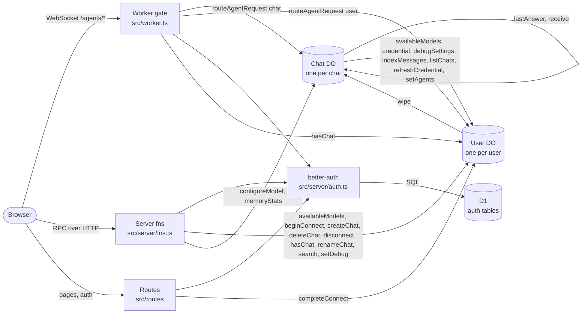

# Architecture

<!-- Generated by scripts/infra-map.ts from the code and the local SQLite files. Do not edit; run `node scripts/infra-map.ts`. `--check` verifies. -->

## Map

## Objects

| Binding | Kind | Class | Instance key | Owner |
|---|---|---|---|---|
| `DB` | D1.Database | - | - | shared by all users, better-auth tables only |
| `BETTER_AUTH_SECRET` | secret (.env) | - | - | Worker env |
| `User` | Durable Object | User extends Agent (src/server/user.ts) | user id | one instance per user |
| `Chat` | Durable Object | Chat extends DurableObject + Lifecycle + PiHarness (src/server/chat.ts) | `<userId>--<chatId>` | one instance per chat in the user's User catalog |

## Storage

Scope: `user`/`chat` = per User/Chat instance, `shared` = D1, `agent` = agents SDK runtime state, `runtime` = workerd.

| Object | Table / kv key | Source | Owner scope | Writers | Readers | In SQLite |
|---|---|---|---|---|---|---|
| D1 | `user` | code: migrations/0001_better_auth.sql:1 | shared | better-auth (server/auth.ts) | better-auth (server/auth.ts) | yes |
| D1 | `session` | code: migrations/0001_better_auth.sql:3 | shared | better-auth (server/auth.ts) | better-auth (server/auth.ts) | yes |
| D1 | `account` | code: migrations/0001_better_auth.sql:5 | shared | better-auth (server/auth.ts) | better-auth (server/auth.ts) | yes |
| D1 | `verification` | code: migrations/0001_better_auth.sql:7 | shared | better-auth (server/auth.ts) | better-auth (server/auth.ts) | yes |
| D1 | `__alchemy_migrations` | library: alchemy | shared | alchemy | alchemy | yes |
| D1 | `_cf_METADATA` | library: workerd internals | runtime | workerd internals | workerd internals | yes |
| User | `chats` | code: server/user.ts:21 | user | server/user.ts:43, server/user.ts:64, server/user.ts:75, server/user.ts:101, server/user.ts:102 | server/user.ts:28, server/user.ts:89, server/user.ts:114 | yes |
| User | `chat_agents` | code: server/user.ts:22 | user | server/user.ts:55, server/user.ts:56, server/user.ts:74 | server/user.ts:29 | yes |
| User | `indexed` | code: server/user.ts:23 | user | server/user.ts:73, server/user.ts:97 | - | yes |
| User | `messages` (FTS5) | code: server/user.ts:24 | user | server/user.ts:72, server/user.ts:98 | server/user.ts:114 | yes |
| User | kv `siwc:connection` | code: server/user.ts:133 | user | server/user.ts:143, server/user.ts:148, server/user.ts:189 | server/user.ts:133, server/user.ts:155, server/user.ts:183 | n/a |
| User | kv `siwc:host` | code: server/user.ts:127 | user | server/user.ts:128 | server/user.ts:127 | n/a |
| User | kv `siwc:models` | code: server/user.ts:149 | user | server/user.ts:149, server/user.ts:176 | server/user.ts:162 | n/a |
| User | kv `siwc:pending` | code: server/user.ts:134 | user | server/user.ts:134, server/user.ts:141 | server/user.ts:139 | n/a |
| User | `messages_config`, `messages_content`, `messages_data`, `messages_docsize`, `messages_idx` | library: FTS5 shadow tables of `messages` | user | FTS5 shadow tables of `messages` | FTS5 shadow tables of `messages` | yes |
| User | `cf_agent_tool_runs`, `cf_agents_facet_runs`, `cf_agents_fibers`, `cf_agents_jobs`, `cf_agents_mcp_servers`, `cf_agents_runs`, `cf_agents_state`, `cf_agents_task_runs`, `cf_agents_task_steps`, `cf_agents_workflows` | library: agents SDK (Agent / Lifecycle) | agent | agents SDK (Agent / Lifecycle) | agents SDK (Agent / Lifecycle) | yes |
| User | `_cf_KV` | library: workerd internals | runtime | workerd internals | workerd internals | yes |
| Chat | `optchat_log` | code: optchat/store.ts:6 | chat | optchat/store.ts:17 | optchat/store.ts:11 | yes |
| Chat | `optchat_tree` | code: optchat/store.ts:7 | chat | optchat/store.ts:21 | optchat/store.ts:12 | yes |
| Chat | `optchat_view` | code: optchat/store.ts:8 | chat | optchat/store.ts:25 | optchat/store.ts:13 | yes |
| Chat | kv `index:sent` | code: server/chat.ts:175 | chat | server/chat.ts:183 | server/chat.ts:175 | n/a |
| Chat | kv `optchat:logged` | code: server/chat.ts:165 | chat | server/chat.ts:169 | server/chat.ts:165 | n/a |
| Chat | `cf_agents_jobs` | library: agents SDK (Agent / Lifecycle) | agent | agents SDK (Agent / Lifecycle) | agents SDK (Agent / Lifecycle) | yes |
| Chat | `pi_conversations`, `pi_document_revisions`, `pi_documents`, `pi_durable_metadata`, `pi_durable_schema`, `pi_entries`, `pi_record_ids`, `pi_submissions`, `pi_tasks` | library: pi-durable (PiHarness) | chat | pi-durable (PiHarness) | pi-durable (PiHarness) | yes |
| Chat | `_cf_KV`, `_cf_METADATA` | library: workerd internals | runtime | workerd internals | workerd internals | yes |

## RPC edges

| From | To | Method | file:line |
|---|---|---|---|
| Chat | Chat | `lastAnswer` | src/server/chat.ts:107 |
| Chat | Chat | `receive` | src/server/chat.ts:105 |
| Chat | User | `availableModels` | src/server/chat.ts:126 |
| Chat | User | `credential` | src/server/chat.ts:44 |
| Chat | User | `debugSettings` | src/server/chat.ts:63 |
| Chat | User | `indexMessages` | src/server/chat.ts:182 |
| Chat | User | `listChats` | src/server/chat.ts:104, src/server/chat.ts:140 |
| Chat | User | `refreshCredential` | src/server/chat.ts:94 |
| Chat | User | `setAgents` | src/server/chat.ts:109 |
| Server fns | Chat | `configureModel` | src/server/fns.ts:42 |
| Server fns | Chat | `memoryStats` | src/server/fns.ts:29 |
| Server fns | User | `availableModels` | src/server/fns.ts:38 |
| Server fns | User | `beginConnect` | src/server/fns.ts:19 |
| Server fns | User | `createChat` | src/server/fns.ts:18 |
| Server fns | User | `deleteChat` | src/server/fns.ts:35 |
| Server fns | User | `disconnect` | src/server/fns.ts:20 |
| Server fns | User | `hasChat` | src/server/fns.ts:12 |
| Server fns | User | `renameChat` | src/server/fns.ts:32 |
| Server fns | User | `search` | src/server/fns.ts:23 |
| Server fns | User | `setDebug` | src/server/fns.ts:26 |
| User | Chat | `wipe` | src/server/user.ts:71 |
| Worker gate | User | `hasChat` | src/worker.ts:24 |
| Worker route | User | `completeConnect` | src/routes/auth.callback.ts:11 |

## Routes

| Path | Auth rule |
|---|---|
| `/agents/chat/:name` | 401 without session; 403 unless `name` is `<callerId>--<chatId>` and `User.hasChat(chatId)` |
| `/agents/user/:name` | 401 without session; 403 unless `name` is the caller's id |
| `everything else` | TanStack Start handler (rule per route below) |
| `/api/auth/*` | better-auth handler (sign-in/up are public) |
| `/auth/callback` | `requireUser`: 401 without session |
| `/` | session or redirect to /login |
| `/login` | public |
| `serverFn getSession (GET)` | public (returns session or null) |
| `serverFn createChat (POST)` | `requireUser` |
| `serverFn connectChatGPT (POST)` | `requireUser` |
| `serverFn disconnectChatGPT (POST)` | `requireUser` |
| `serverFn searchMessages (GET)` | `requireUser` |
| `serverFn setDebug (POST)` | `requireUser` |
| `serverFn memoryStats (GET)` | `requireUser` + `User.hasChat` |
| `serverFn renameChat (POST)` | `requireUser` + `User.hasChat` |
| `serverFn deleteChat (POST)` | `requireUser` + `User.hasChat` |
| `serverFn modelOptions (GET)` | `requireUser` |
| `serverFn setChatModel (POST)` | `requireUser` + `User.hasChat` |
